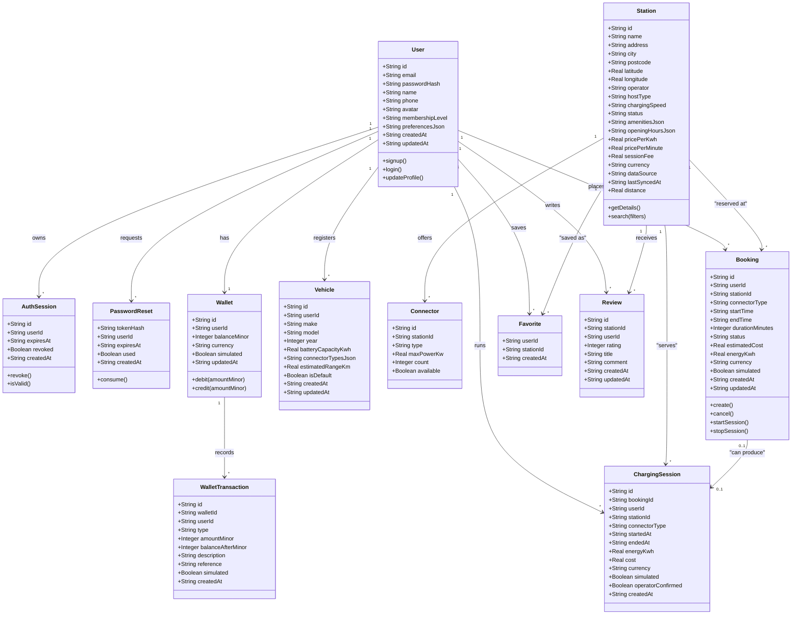
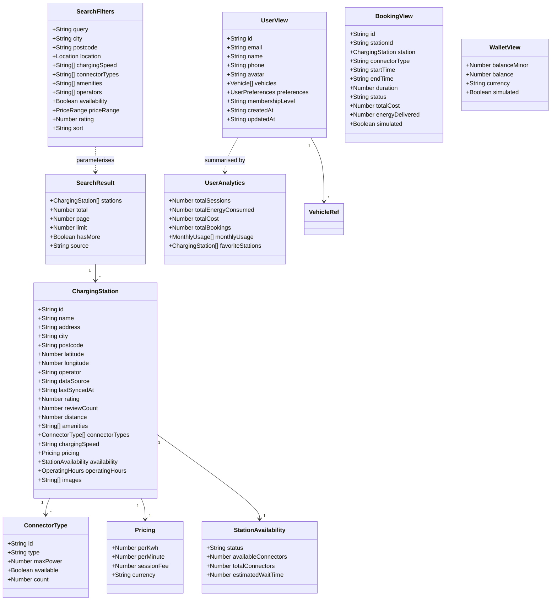
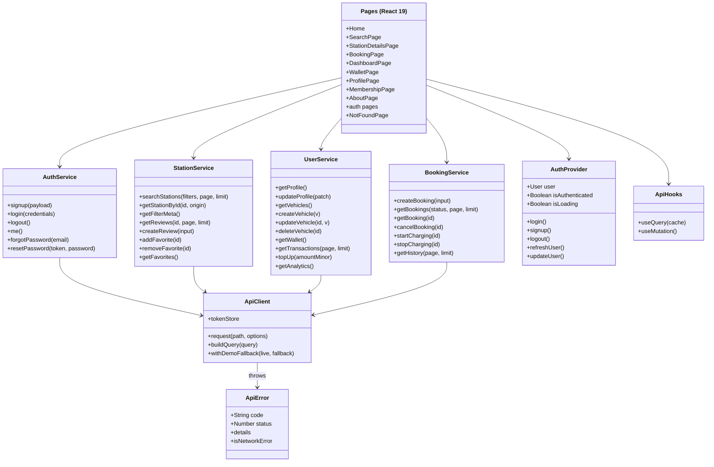

# 03 — Class Diagram

The backend is deliberately not object-oriented: it is a layered Express
application whose persistence model *is* the SQLite schema
(`backend/src/db.js`). The classes below therefore come from three places:

1. **Persistence entities** — one class per table, with the columns from the
   migration. See [06-er-diagram.md](06-er-diagram.md) for keys and indexes.
2. **API resources** — the shapes produced by `backend/src/serializers.js` and
   consumed by the frontend types in `frontend/src/types/index.ts`.
3. **Frontend service layer** — the four service objects in
   `frontend/src/services/api.ts` (`authService`, `stationService`,
   `userService`, `bookingService`) plus the React state holders
   (`useAuth`, `useGeolocation`, `useDocumentTitle`).

## Domain and persistence model

> `distance` on `Station` is not a column: it is computed per request from the
> supplied origin (`calculateDistance` on the client, Haversine on the server) and
> attached to the serialized resource.

## API resource shapes

## Frontend service and state layer

**Evidence for this chapter**

* Columns: `backend/src/db.js` (migration `core_schema`).
* Serializers: `backend/src/serializers.js`.
* Types: `frontend/src/types/index.ts`.
* Services: `frontend/src/services/api.ts`; state: `frontend/src/hooks/useAuth.tsx`.
