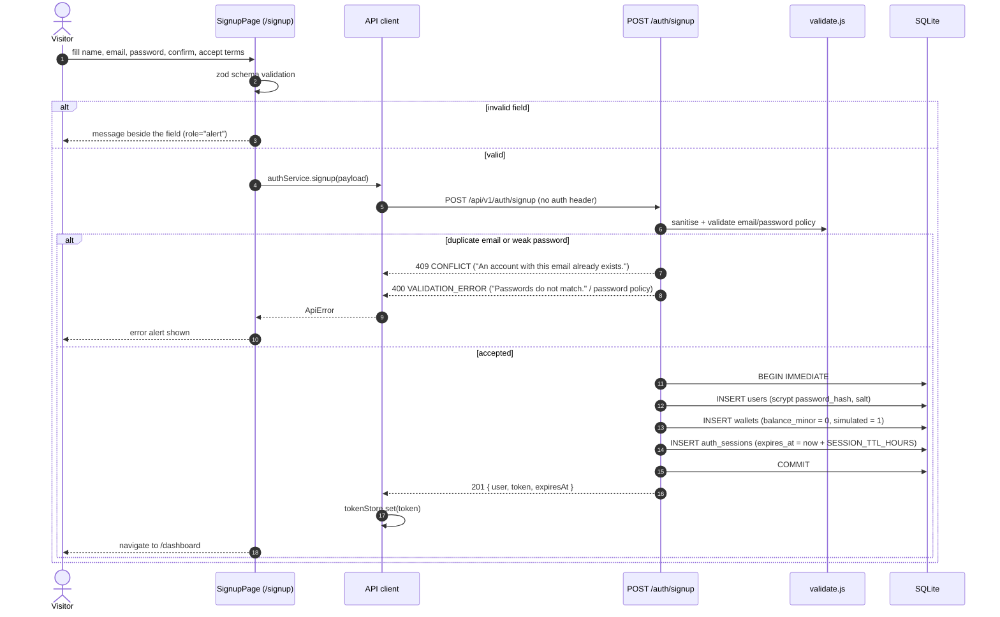
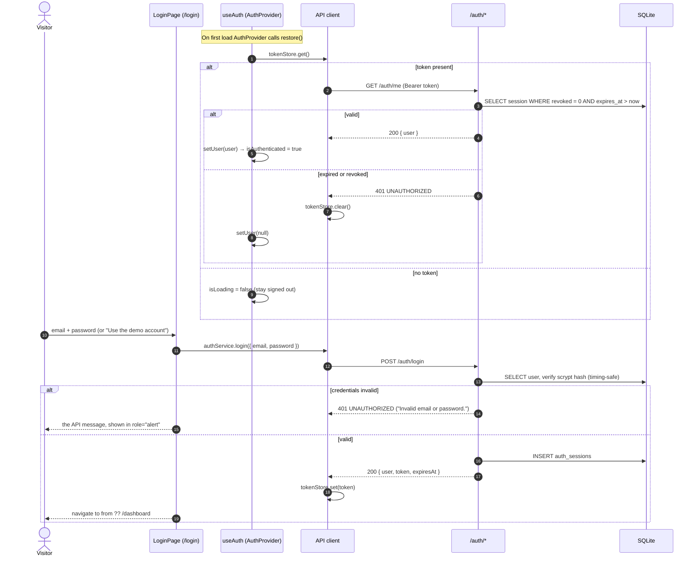
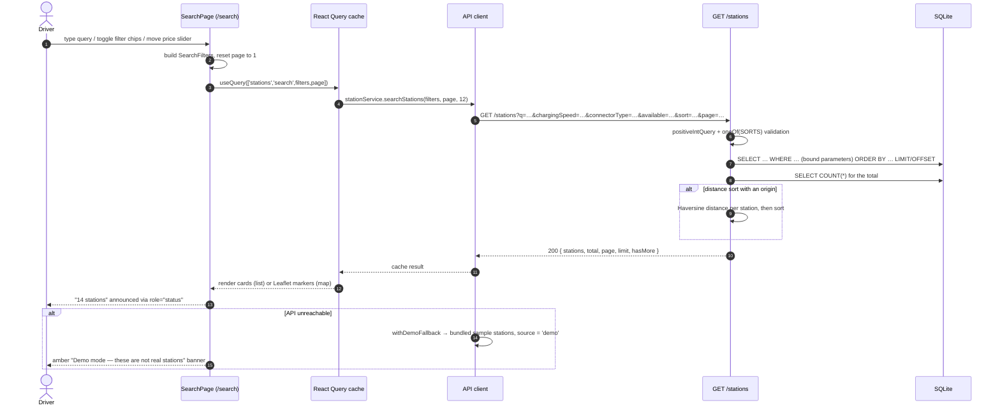
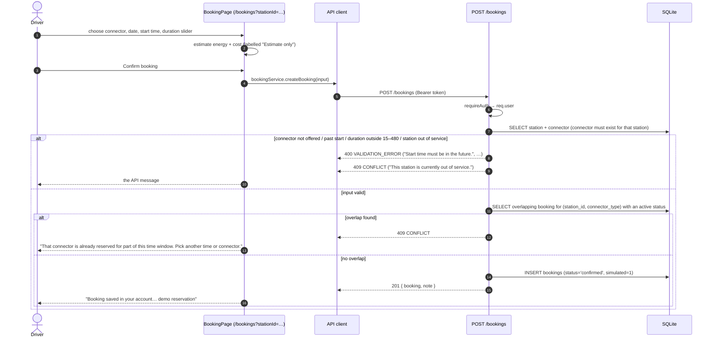
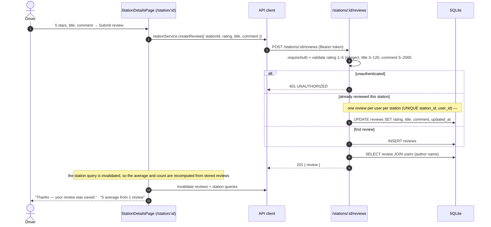
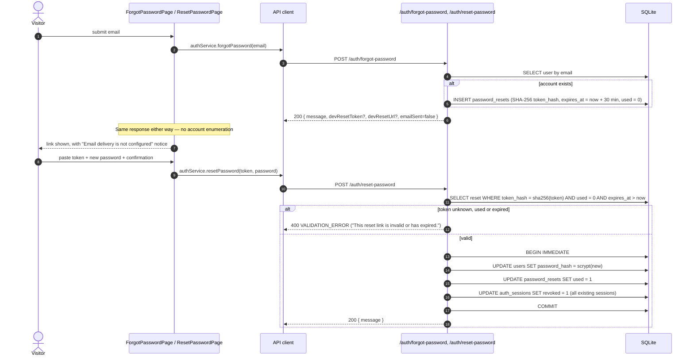

# 04 — Sequence Diagrams

Participants are the real modules of this system:

| Alias | Module |
| --- | --- |
| Browser UI | React pages/components (`frontend/src/pages`, `frontend/src/components`) |
| Auth provider | `frontend/src/hooks/useAuth.tsx` |
| API client | `frontend/src/services/api.ts` (adds the `Authorization: Bearer` header) |
| API | Express routers (`backend/src/routes/*.js`) |
| Validate / repo | `backend/src/validate.js`, `backend/src/repo.js` |
| DB | SQLite via `node:sqlite` (`backend/src/db.js`) |

---

## 1. Sign-up (UC-02)



## 2. Sign-in and session restore (UC-03, FR-7)



> Note: an unreachable API (`NETWORK_ERROR`, status 0) does **not** clear the stored
> token, so a network blip never signs a driver out. Covered by
> `ProtectedRoute.test.tsx`.

## 3. Station search with filters (UC-06, UC-07)



## 4. Create a booking with conflict detection (UC-13, FR-21)



## 5. Charging session and wallet debit (UC-15, FR-25/26)

```mermaid
sequenceDiagram
  autonumber
  actor D as Driver
  participant UI as BookingPage
  participant C as API client
  participant API as /bookings/:id/*
  participant DB as SQLite

  D->>UI: Start charging
  UI->>C: bookingService.startCharging(id)
  C->>API: POST /bookings/:id/start
  API->>DB: SELECT booking WHERE id
  alt booking belongs to another user
    API-->>C: 403 FORBIDDEN
  else not confirmed
    API-->>C: 409 CONFLICT ("Only a confirmed booking can be started (current: …).")
  else confirmed
    API->>DB: BEGIN IMMEDIATE
    API->>DB: UPDATE bookings SET status='active'
    API->>DB: INSERT charging_sessions (simulated=1, operator_confirmed=0)
    API->>DB: COMMIT
    API-->>C: 200 { session, note }
    UI-->>D: "Charging session started (simulated — no real hardware)"
  end

  D->>UI: Stop charging
  UI->>C: bookingService.stopCharging(id)
  C->>API: POST /bookings/:id/stop
  API->>DB: SELECT open session + station price
  API->>API: energy = f(duration, power); cost = energy × price + session fee
  API->>DB: SELECT wallet balance
  alt booking is not active / no open session
    API-->>C: 409 CONFLICT ("Only an active booking can be stopped.")
  else balance < cost
    API-->>C: 409 CONFLICT ("Insufficient wallet balance for this operation.")
    Note over API,DB: no writes — session stays open, booking stays active
    UI-->>D: the API message explains the wallet is short
  else sufficient
    API->>DB: BEGIN IMMEDIATE
    API->>DB: UPDATE wallets SET balance_minor = balance_minor − cost
    API->>DB: INSERT wallet_transactions (type='charge', balance_after_minor)
    API->>DB: UPDATE charging_sessions SET ended_at, energy_kwh, cost
    API->>DB: UPDATE bookings SET status='completed'
    API->>DB: COMMIT
    API-->>C: 200 { chargingCost, charged: true, note }
    UI-->>D: "Session ended. Estimated cost $1.28 was deducted from your demo wallet."
  end
```

## 6. Review submission and rating aggregation (UC-12, FR-31)



## 7. Password reset (UC-04, FR-8/9)


