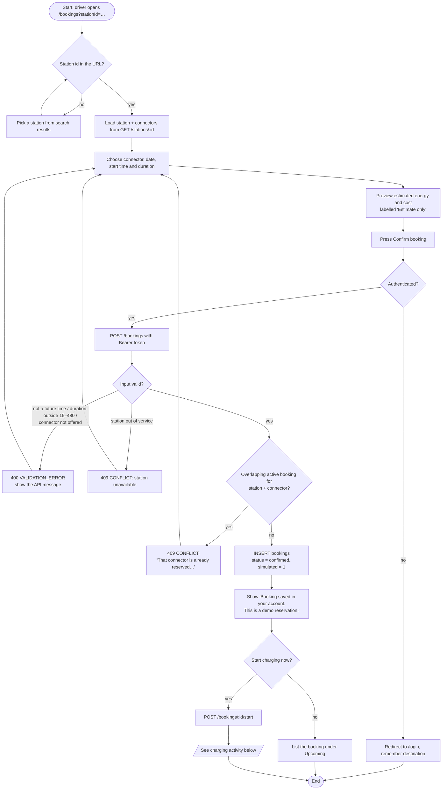
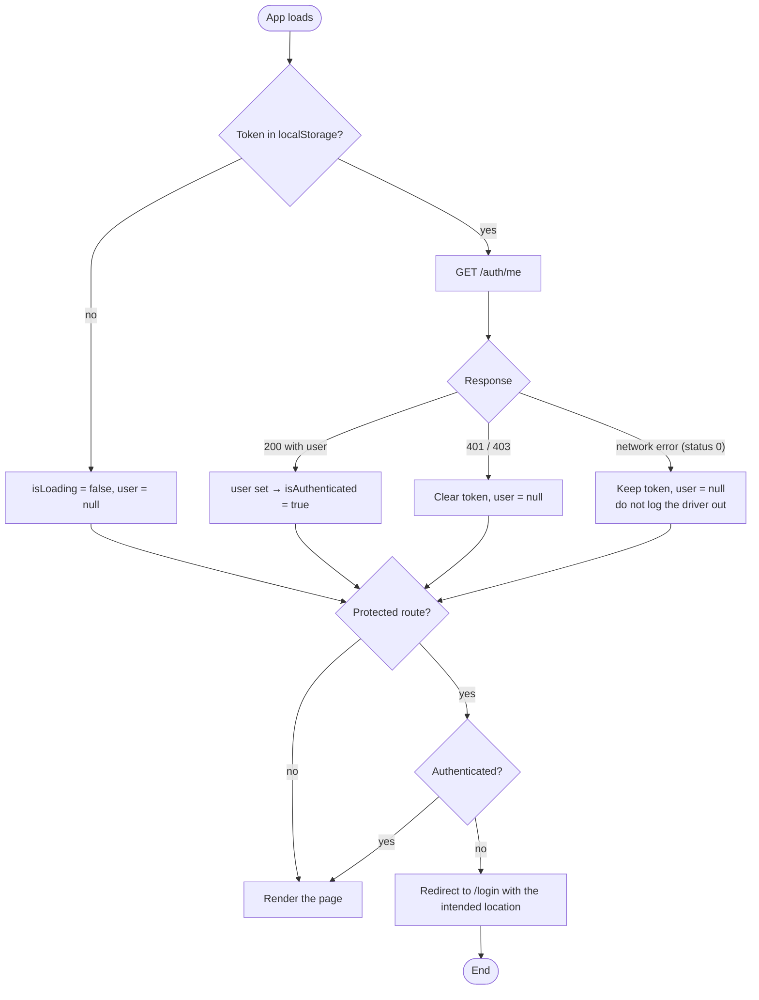
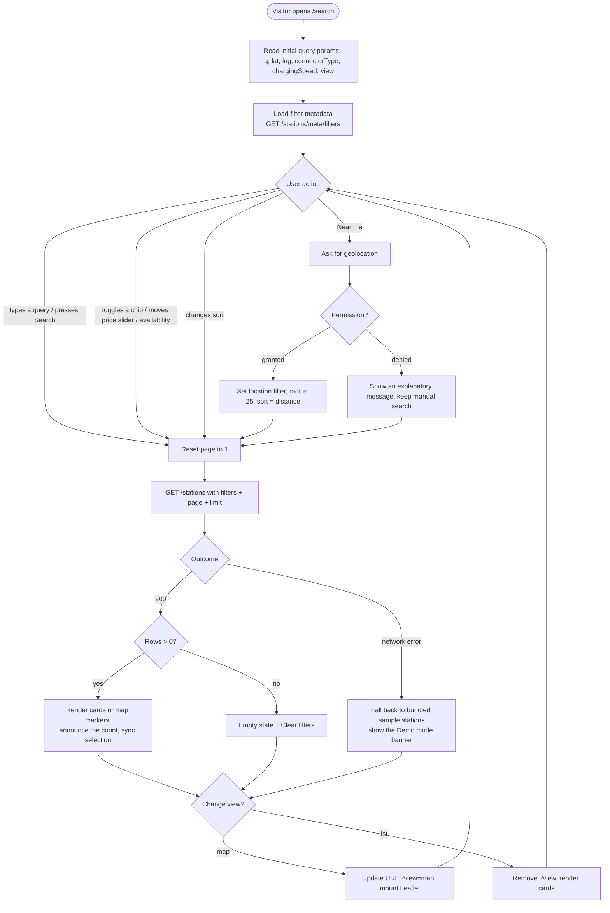

# 05 — Activity Diagrams

## 1. Booking activity (UC-13, FR-19…FR-21)



## 2. Charging session activity (UC-15, FR-24…FR-26)

```mermaid
flowchart TD
  A([Driver taps Start charging]) --> B{Booking status = confirmed?}
  B -- no --> B1[409 CONFLICT: only a confirmed booking can start] --> Z([End])
  B -- yes --> C[BEGIN IMMEDIATE]
  C --> D[UPDATE bookings → active]
  D --> E[INSERT charging_sessions<br/>simulated = 1, operator_confirmed = 0]
  E --> F[COMMIT] --> G[UI: 'Charging session started (simulated)']

  G --> H[Driver taps Stop charging]
  H --> I{Open session for this booking?}
  I -- no --> I1[409 CONFLICT: no open session / not active] --> Z
  I -- yes --> J[Compute energy from duration and connector power]
  J --> K[cost = energy × price_per_kwh + session_fee]
  K --> L{Wallet balance ≥ cost?}
  L -- no --> L1[409 CONFLICT: 'Insufficient wallet balance'<br/>no writes — session stays open] --> Z
  L -- yes --> M[BEGIN IMMEDIATE]
  M --> N[UPDATE wallets: balance − cost]
  N --> O[INSERT wallet_transactions<br/>type = charge, balance_after_minor]
  O --> P[UPDATE charging_sessions: ended_at, energy, cost]
  P --> Q[UPDATE bookings → completed]
  Q --> R[COMMIT]
  R --> S[UI: cost deducted from the demo wallet] --> Z
```

## 3. Session restore and protected access (FR-7, FR-10)



## 4. Search, filter and sort activity (UC-06, UC-07, UC-18)


