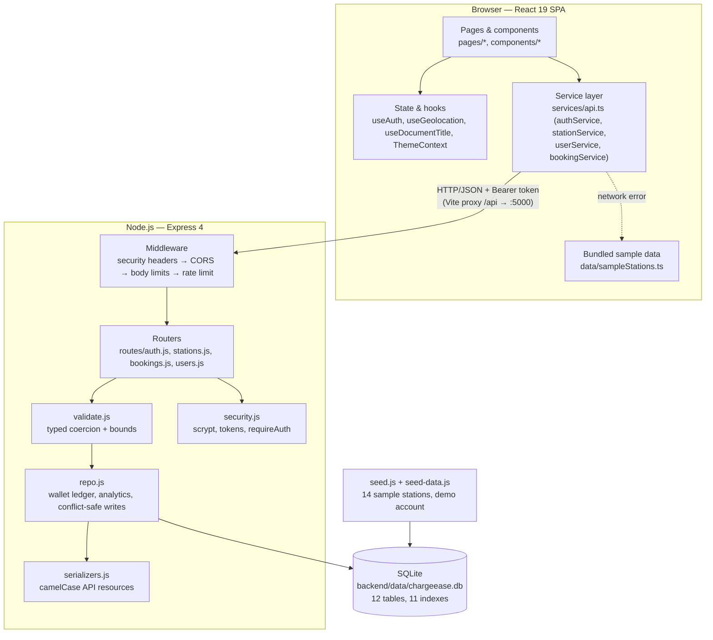
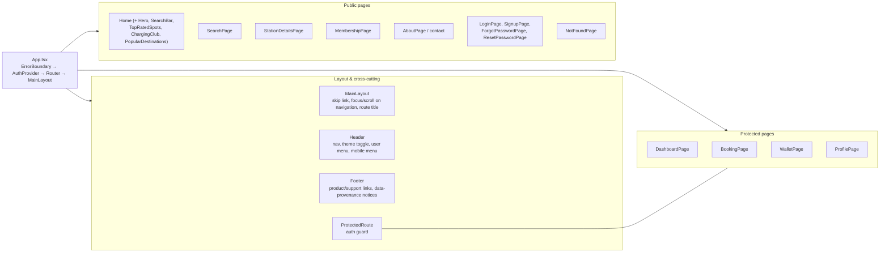
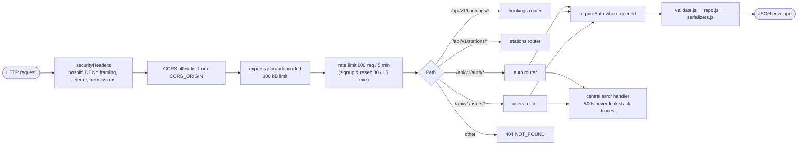
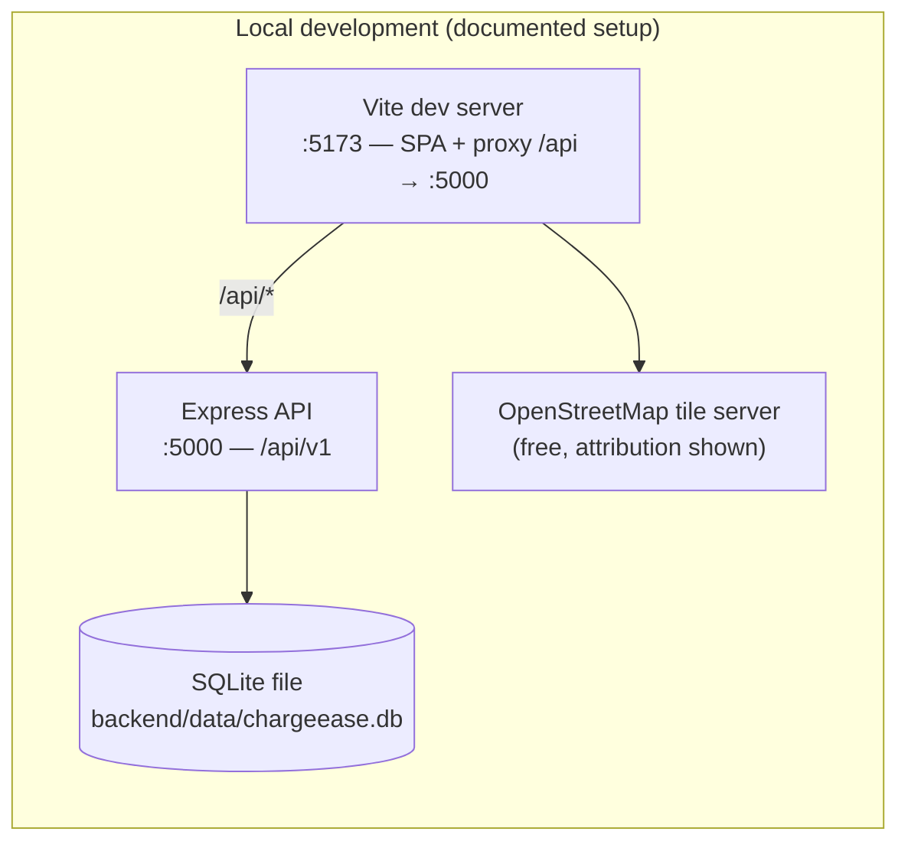

# 07 — Architecture

## 1. Technology stack

| Layer | Technology | Version | Why |
| --- | --- | --- | --- |
| UI | React | 19 | Component model, hooks |
| Language | TypeScript | 5.7 | Typed API contracts across the app |
| Build | Vite | 6 | Fast dev server, route-level code splitting |
| Styling | Tailwind CSS | 4 (`@tailwindcss/vite`) | Utility CSS compiled at build time; light/dark via CSS variables |
| Routing | react-router-dom | 7 | Client-side routes, protected routes |
| Server state | @tanstack/react-query | 5 | Caching, retries, invalidation for API data |
| Forms | react-hook-form + zod + @hookform/resolvers | 7 / 4 / 5 | Schema validation with field-level messages |
| Animation | framer-motion | 12 | Motion on marketing surfaces, respects reduced motion |
| Maps | leaflet + react-leaflet | 1.9 / 5 | Free OSM tiles; loaded only on map routes |
| Icons | lucide-react | 0.468 | Consistent icon set |
| HTTP API | Express | 4 | Minimal, well-understood router |
| Runtime | Node.js | ≥ 22.5 | Required for the built-in `node:sqlite` module |
| Database | SQLite via `node:sqlite` | built-in | Zero-install, file-based, ACID; no native build step |
| Security | `node:crypto` (scrypt, SHA-256, HMAC), `express-rate-limit`, `cors` | — | No paid service and no heavyweight dependency |
| Tests | `node --test` (backend), Vitest + Testing Library + jsdom (frontend) | 3 / 16 | Both run offline |
| Lint / types | ESLint 9 + typescript-eslint, `tsc -b` | — | 0 lint errors, strict TypeScript |

No paid, proprietary or cloud service is required to run or test the project.

## 2. Layered architecture



## 3. Component view (frontend)



## 4. Backend request pipeline



Every response uses the same envelope:

```json
// success
{ "success": true, "data": { } }
// failure
{ "success": false, "error": { "code": "CONFLICT", "message": "…", "details": { } } }
```

## 5. Deployment view



Any static host can serve `frontend/dist`, and any Node host can run the API; a
reverse proxy that forwards `/api` to the API makes the pair same-origin (which is
how the dev proxy behaves). No container, cloud database or paid service is needed.

## 6. Module map

### Backend (`backend/`)

| File | Responsibility |
| --- | --- |
| `server.js` | Compatibility entry point; delegates to `src/index.js` |
| `src/index.js` | Starts the HTTP server, seeds an empty database unless `SEED_ON_START=false` |
| `src/config.js` | Environment parsing and defaults; refuses to start in production without a real `JWT_SECRET` |
| `src/app.js` | Express app: middleware, routers, health route, 404, error handler |
| `src/routes/auth.js` | Sign-up, sign-in, sign-out, session lookup, password reset |
| `src/routes/stations.js` | Search, filter metadata, nearby, detail, reviews, favourites |
| `src/routes/bookings.js` | Create/list/detail/cancel bookings, start/stop sessions, history |
| `src/routes/users.js` | Profile, vehicles, favourites list, wallet + ledger, analytics |
| `src/validate.js` | Coercion, ranges, enum checks, text sanitising |
| `src/repo.js` | Wallet ledger, analytics aggregation, transactional helpers |
| `src/serializers.js` | Database row → API resource (camelCase, parsed JSON columns) |
| `src/security.js` | scrypt hashing/verification, signed session tokens, `requireAuth` |
| `src/db.js` | Migrations, connection handling, transaction/savepoint helper |
| `src/errors.js` | `ApiError` factories (`badRequest`, `unauthorized`, `forbidden`, `notFound`, `conflict`, `tooMany`) |
| `src/seed.js`, `src/seed-data.js` | Idempotent seeding of sample stations and the demo account |
| `test/*.test.js` | 33 API tests run against an in-memory database |

### Frontend (`frontend/src/`)

| Path | Responsibility |
| --- | --- |
| `App.tsx` | Route table, lazy loading, error boundary, auth provider |
| `components/layout/` | `MainLayout`, `Header`, `Footer` |
| `components/auth/ProtectedRoute.tsx` | Redirects anonymous visitors, remembers the destination |
| `components/common/` | `StationMap` (Leaflet/OSM), `ErrorBoundary`, image placeholder |
| `components/ui/` | `Button`, `Input` (labels, errors, `aria-invalid`, password toggle) |
| `components/home/` | Marketing sections and the home search bar |
| `pages/` | One file per route, including `NotFoundPage` |
| `hooks/useAuth.tsx` | Session restore, login/signup/logout, user refresh |
| `hooks/useGeolocation.ts` | "Near me" with permission and watch handling |
| `hooks/useDocumentTitle.ts` | Route → document title mapping |
| `context/ThemeContext.tsx` | Light/dark theme, persisted in `localStorage` |
| `services/api.ts` | Typed API client, `ApiError`, demo fallback, token store |
| `data/sampleStations.ts` | Offline sample stations used for the demo fallback |
| `types/index.ts` | Domain and API types |
| `utils/` | `constants.ts`, `helpers.ts` (formatting, filtering, geo, debounce) |
| `test/` | Vitest setup, provider render helper (`renderWithProviders`), shared domain fixtures (`fixtures.ts`) |
| `*.test.ts(x)` | 76 unit/integration tests in 9 files (helpers, API client, `ProtectedRoute`, `Button`, login, bookings, search, reset password, profile) |

## 7. Cross-cutting decisions

| Decision | Reason | Trade-off |
| --- | --- | --- |
| Session token in `localStorage` | Simplest flow for a local demo; documented in the README | XSS-reachable — HttpOnly cookies are FE-1 |
| Money in minor units | Avoids floating-point drift in the ledger | Callers must divide by 100 for display |
| Sample data instead of a live provider | Runs offline with no API key | Availability is not real; labelled everywhere |
| Demo fallback in `withDemoFallback` | The UI stays demonstrable when the API is down | A stale result can be shown — hence the *Demo mode* banner |
| Route-level code splitting | Keeps the first load small, Leaflet out of the initial bundle | One extra chunk request per route |
| Error codes are generic (`CONFLICT`, `VALIDATION_ERROR`, …) | One predictable contract for the client | The message carries the specific meaning |
